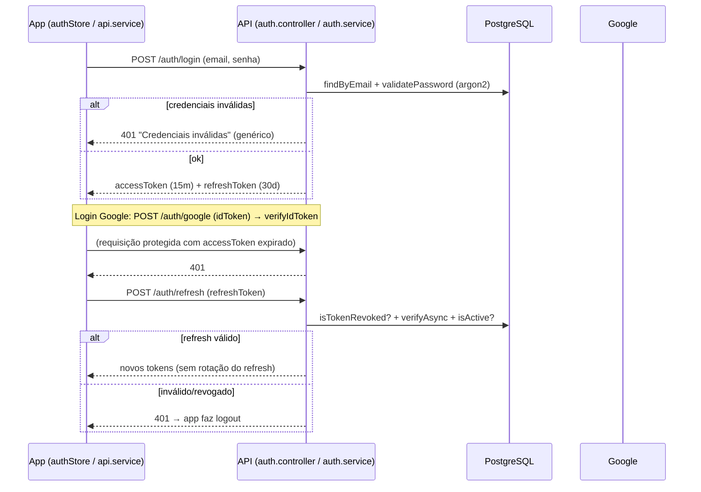
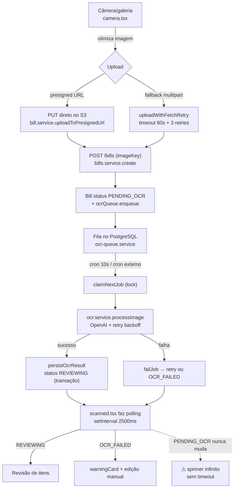
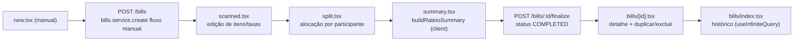

# Auditoria de Fluxos e Tratamento de Falhas — Por Partes / Rateio

> **Status:** Rascunho para revisão da equipe
> **Escopo:** Full stack — aplicativo Expo/React Native (`frontend/`) e API NestJS (`backend/`)
> **Objetivo:** Mapear os fluxos do produto e catalogar os pontos de tratamento de falhas (o que existe e é sólido, o que está ausente/frágil/inconsistente) em três dimensões: erros de runtime, resiliência de integrações e UX de falha.
> **Natureza deste documento:** relatório de auditoria. Ele **descreve achados e riscos**; **não** propõe nem implementa correções de código. As decisões de correção ficam para as etapas seguintes.

As referências de código citam `arquivo:linha` do estado atual do repositório e foram validadas relendo os arquivos. Se o código mudar, revalide as linhas.

---

## Índice

1. [Resumo executivo](#1-resumo-executivo)
2. [Metodologia e legendas](#2-metodologia-e-legendas)
3. [Mapa de fluxos full stack](#3-mapa-de-fluxos-full-stack)
4. [Catálogo de achados — Backend](#4-catálogo-de-achados--backend)
5. [Catálogo de achados — Frontend](#5-catálogo-de-achados--frontend)
6. [Matriz de priorização consolidada](#6-matriz-de-priorização-consolidada)
7. [Casos de uso não previstos (exploratório)](#7-casos-de-uso-não-previstos-exploratório)

---

## 1. Resumo executivo

A base está madura em vários aspectos de resiliência pontual: o cliente HTTP do app tem retry com backoff, refresh de token e recuperação de baseURL; o serviço de OCR tem retry com backoff e classificação de erros da OpenAI; a fila de OCR persiste no banco com locks e liberação de locks obsoletos; a autenticação tem rate limiting granular, anti-enumeração e hashing forte. Porém, faltam **redes de segurança de última camada** em ambos os lados, e há **inconsistências de atomicidade e de contrato de erro** que podem gerar estados corrompidos ou falhas silenciosas.

Os 7 gaps mais críticos para a robustez, na ordem em que recomendamos priorizar a discussão:

| # | Gap | Área | Severidade |
| --- | --- | --- | --- |
| 1 | **Sem `ExceptionFilter` global** — erros do Prisma e não-Http viram HTTP 500 opaco, e mensagens internas vazam ao cliente | Backend | Crítico |
| 2 | **Sem `ErrorBoundary` no app** — qualquer exceção de render derruba a tela sem fallback | Frontend | Crítico |
| 3 | **Segredos com fallback hardcoded** (JWT/refresh) e **sem validação de env** no boot — app sobe com segredos previsíveis | Backend | Crítico |
| 4 | **Operações multi-passo sem `$transaction`** (finalize, update/batch de itens, duplicate, exclusão de conta, reset de senha) — inconsistência em falha parcial | Backend | Alto |
| 5 | **Polling de OCR sem timeout/limite** — spinner infinito se o OCR travar em `PENDING_OCR`; a ação `retryOcr` existe mas nenhuma tela a expõe | Frontend | Alto |
| 6 | **`/metrics` público sem guard** e **`/health` vaza `error.message`** e sempre responde `status:'ok'` | Backend | Alto |
| 7 | **Fail-open na verificação da blacklist de token** — access token revogado pode passar durante instabilidade do banco | Backend | Alto |

Observações transversais que amplificam o risco: o **logger do app é no-op em produção** (falhas invisíveis, sem crash reporting), **não há detecção de offline nem persistência do rascunho de rateio**, e o **formato de erro é inconsistente entre os serviços do app**.

---

## 2. Metodologia e legendas

A auditoria combinou leitura direta dos arquivos-chave e buscas por padrões (ex.: ausência de `@Catch`/`ExceptionFilter`, de `ErrorBoundary`, de `persist`, de `$transaction`). Cada achado recebe uma ficha padronizada e é classificado por **dimensão** e **severidade**.

### Legenda de dimensão

| Dimensão | Significado |
| --- | --- |
| **Runtime** | Erros/exceções em tempo de execução: try/catch, propagação, validação, crash de render, estados inconsistentes |
| **Integração** | Resiliência de dependências externas: banco, S3, OpenAI, SMTP, fila; timeouts, retries, idempotência, atomicidade |
| **UX** | Experiência de falha do usuário: mensagens, estados de loading/erro/vazio, offline, feedback |

### Legenda de severidade

| Nível | Definição objetiva |
| --- | --- |
| **Crítico** | Pode causar perda de dados, bypass de autenticação/autorização, ou indisponibilidade do serviço/tela |
| **Alto** | Degradação séria da experiência, ou inconsistência de dados recuperável, ou falha silenciosa relevante |
| **Médio** | Falha localizada com workaround possível; impacto contido a um fluxo específico |
| **Baixo** | Higiene de código, cosmético, ou risco teórico de baixa probabilidade |

### Template de ficha de achado

Cada achado segue este formato:

- **ID** — identificador estável (ex.: `BE-01`, `FE-03`)
- **Título** — resumo em uma linha
- **Área** — módulo/tela
- **Dimensão** — Runtime / Integração / UX
- **Localização** — `arquivo:linha`
- **Descrição** — o que o código faz hoje
- **Risco** — o que pode dar errado
- **Severidade** — Crítico / Alto / Médio / Baixo
- **Racional** — por que essa severidade

---

## 3. Mapa de fluxos full stack

O produto tem duas colunas principais: **autenticação/sessão** e **ciclo de vida da conta** (criação → OCR/revisão → participantes → divisão → taxas → finalização → histórico). Abaixo, cada fluxo com a trilha de arquivos e onde vive o tratamento de erro/UX hoje.

### 3.1 Autenticação e sessão

Trilha e tratamento de erro/UX:
- **Login** — `frontend/app/(auth)/login.tsx` (react-hook-form + zod, erro inline, mapeamento por código) → `backend/src/auth/auth.controller.ts` (throttle 3/min) → `backend/src/auth/auth.service.ts:67-104` (anti-enumeração em `:71` e `:89`).
- **Registro** — `frontend/app/(auth)/register.tsx` → `auth.service.ts`; recusa criar ADMIN; `setTimeout(500ms)` pós-sucesso é frágil (ver `FE-08`).
- **Google** — `auth.service.ts:105-137` + `backend/src/auth/google-token.service.ts` (valida audiência/`iss`/`email_verified`).
- **Refresh** — cliente em `frontend/services/api.service.ts` (interceptor 401 + fila de refresh) → `auth.service.ts:181-201` (sem rotação, `catch {}` genérico em `:198-200`).
- **Forgot/Reset senha** — `frontend/app/(auth)/forgot-password.tsx` / `reset-password.tsx` → `auth.service.ts:227-289` (mensagem genérica anti-enumeração; reset não transacional em `:270-282`).
- **Sessão no boot** — `frontend/store/authStore.ts:216+` (`loadTokens` distingue 401 / rede / servidor).
- **Guard/estratégia** — `backend/src/auth/strategies/jwt.strategy.ts` (fail-open na blacklist em `:35-48`).

### 3.2 Ciclo de vida da conta com imagem (upload + OCR)

Trilha e tratamento de erro/UX:
- **Captura/otimização/upload** — `frontend/app/(tabs)/(create)/camera.tsx` (mapeamento HTTP completo: 400/401/413/500/503/timeout/network/ocr) → `frontend/services/bill.service.ts` (`uploadToPresignedUrl` sem timeout próprio; `uploadWithFetchRetry` com timeout 60s + 3 retries).
- **Criação/enfileiramento** — `backend/src/bills/bills.service.ts` (`create`: valida tipo/tamanho, faz upload, cria bill `PENDING_OCR`, `ocrQueue.enqueue`).
- **Fila** — `backend/src/ocr/ocr-queue.service.ts` (locks, `releaseStaleLocks`, `claimNextJob`, `failJob` com retry/`OCR_FAILED`; `persistOcrResult` usa `$transaction`).
- **OCR** — `backend/src/ocr/ocr.service.ts` (retry com backoff, `handleOpenAiError`, fallbacks de parsing).
- **Cron interno** — `backend/src/ocr/ocr-internal.controller.ts` (protegido por `INTERNAL_CRON_SECRET`/`CRON_SECRET`).
- **Polling/revisão** — `frontend/app/(tabs)/(create)/scanned.tsx` (polling sem timeout; `OCR_FAILED` tratado com `warningCard`).

### 3.3 Criação manual e ciclo de divisão

Trilha e tratamento de erro/UX:
- **Manual** — `frontend/app/(tabs)/(create)/new.tsx` (zod: taxa 0–100, couvert ≥0, mínimo 1 participante) → `backend/src/bills/bills.service.ts` (fluxo manual com saga de deletes compensatórios, sem `$transaction`, e vazamento de `error.message` em `:315,:344,:380,:392`).
- **Alocação/validação** — `frontend/lib/rateio.ts` (`validateItemAllocations` bloqueia divisão que não fecha; `buildRateioSummary` calcula no cliente).
- **Finalização** — `backend/src/bills/bills.service.ts` (`finalize` faz `division.upsert` em loop + `fee.deleteMany`/`create` + `bill.update` sem transação).
- **Taxas** — `backend/src/fees/fees.service.ts` (`recalculateBillTotal:124`; divergência COVER_CHARGE em `:151-154`).
- **Histórico/detalhe** — `frontend/app/(tabs)/bills/index.tsx` (estados loading/erro/vazio + "Tentar novamente") e `bills/[id].tsx` (recalcula no cliente; `catch` engole erro em `setDetail(null)`).

---

## 4. Catálogo de achados — Backend

### BE-01 — Ausência de ExceptionFilter global
- **Área:** Bootstrap / tratamento global
- **Dimensão:** Runtime / Integração
- **Localização:** `backend/src/main.ts` (bootstrap sem `useGlobalFilters`); `backend/src/app.module.ts:55-62` (só `APP_GUARD` + `APP_INTERCEPTOR`, nenhum `APP_FILTER`)
- **Descrição:** Não há nenhum `@Catch`/`ExceptionFilter` registrado. Erros que não derivam de `HttpException` (Prisma `P2002`/`P2025`, `TypeError`, falhas de S3/SMTP que escapem de try/catch) caem no handler padrão do Nest.
- **Risco:** Qualquer erro conhecido do Prisma vira `500 Internal server error` opaco, sem status semântico (409/404). O cliente não consegue tratar de forma útil, e a observabilidade fica pobre.
- **Severidade:** **Crítico**
- **Racional:** Camada de segurança de última linha ausente para todo o backend; afeta previsibilidade de todas as rotas.

### BE-02 — Segredos JWT com fallback hardcoded
- **Área:** Autenticação
- **Dimensão:** Runtime (segurança)
- **Localização:** `backend/src/auth/auth.module.ts` (`JWT_SECRET || 'your-secret-key-change-in-production'`); `backend/src/auth/strategies/jwt.strategy.ts:17-18`; `backend/src/auth/auth.service.ts:159,186,212` (`JWT_REFRESH_SECRET || 'refresh-secret-key'`)
- **Descrição:** Se as variáveis de ambiente faltarem, a aplicação **sobe** usando segredos previsíveis embutidos no código.
- **Risco:** Em um ambiente mal configurado, tokens podem ser forjados por qualquer um que conheça o valor padrão (que está no repositório). Bypass total de autenticação.
- **Severidade:** **Crítico**
- **Racional:** Falha silenciosa de configuração com impacto direto de segurança.

### BE-03 — Sem validação de variáveis de ambiente no boot
- **Área:** Configuração
- **Dimensão:** Integração
- **Localização:** ausência de `ConfigModule.forRoot({ validationSchema })`/Joi/Zod em todo `backend/src` (grep sem matches); envs lidas direto de `process.env` com fallbacks
- **Descrição:** Nenhuma validação fail-fast de env. Fallbacks perigosos: JWT (BE-02), `AWS_S3_ACCESS_KEY/SECRET_KEY → ''` (BE-09), `SMTP_*` indefinido (BE-13).
- **Risco:** App sobe "verde" mas quebra só em runtime, no primeiro uso do recurso mal configurado — e, combinado com BE-01, vira 500 opaco.
- **Severidade:** **Alto**
- **Racional:** Amplifica vários outros achados; transforma erro de configuração em incidente de produção difícil de diagnosticar.

### BE-04 — Fail-open na verificação da blacklist de token
- **Área:** Autenticação
- **Dimensão:** Runtime (segurança)
- **Localização:** `backend/src/auth/strategies/jwt.strategy.ts:35-48` (try/catch em torno de `isTokenRevoked`; `console.warn` em `:46` e segue autenticando)
- **Descrição:** Se a checagem de revogação lançar (ex.: banco indisponível), o erro é logado e a autenticação **continua**. Comentário no código assume isso intencionalmente.
- **Risco:** Um access token revogado (logout, comprometimento) pode ser aceito durante instabilidade do banco.
- **Severidade:** **Alto**
- **Racional:** Escolha de disponibilidade sobre segurança em componente de auth; janela de bypass condicionada a falha de infra.

### BE-05 — Refresh token sem rotação nem detecção de reuso
- **Área:** Autenticação
- **Dimensão:** Runtime (segurança)
- **Localização:** `backend/src/auth/auth.service.ts:181-201` (gera novos tokens sem revogar o refresh usado; `catch {}` genérico em `:198-200`)
- **Descrição:** O refresh token não é rotacionado no `refreshTokens`, então o mesmo refresh pode ser reutilizado por 30 dias, sem detecção de reuso.
- **Risco:** Refresh vazado permanece válido por todo o período; sem detecção de reuso, não há sinal de comprometimento.
- **Severidade:** **Alto**
- **Racional:** Padrão de segurança de sessão ausente; janela longa de exposição.

### BE-06 — `logoutAllDevices` remove registros de revogação em vez de invalidar sessões
- **Área:** Autenticação
- **Dimensão:** Runtime (segurança)
- **Localização:** `backend/src/token-revocation/token-revocation.service.ts:35-39` (`revokeAllUserTokens` faz `deleteMany`)
- **Descrição:** A operação apaga os registros de tokens revogados do usuário, em vez de marcar os tokens ativos como revogados. O nome sugere "deslogar de todos os dispositivos", mas o efeito não invalida sessões ativas.
- **Risco:** Usuário acredita ter encerrado todas as sessões, mas refresh tokens ativos continuam válidos.
- **Severidade:** **Alto**
- **Racional:** Comportamento contradiz a expectativa de segurança da funcionalidade.

### BE-07 — Operações multi-passo sem transação
- **Área:** Domínio (bills, users, auth)
- **Dimensão:** Integração (atomicidade)
- **Localização:** `backend/src/bills/bills.service.ts` (`finalize`: `division.upsert` em loop + `fee.deleteMany`/`create` + `bill.update`; `update` e `batchUpdateItems`: `deleteMany` seguido de `createMany`; `duplicate`; fluxo manual de `create` com saga manual de deletes em `:310-395`); `backend/src/users/users.service.ts` (`deleteOwnAccount`); `backend/src/auth/auth.service.ts:270-282` (`resetPassword`)
- **Descrição:** Sequências de escrita não são atômicas. Uma falha no meio deixa dados inconsistentes (ex.: taxas apagadas sem recriar; itens deletados sem recriar; token de reset consumido sem senha trocada).
- **Risco:** Corrupção de estado da conta e da senha; a compensação manual (deletes no catch) pode ela mesma falhar.
- **Severidade:** **Alto**
- **Racional:** Inconsistência de dados de negócio, recuperável mas silenciosa e de diagnóstico difícil.

### BE-08 — Race em register/createGoogleUser (P2002 não tratado)
- **Área:** Usuários / Autenticação
- **Dimensão:** Runtime / Integração
- **Localização:** `backend/src/users/users.service.ts:39-46` (register: `findUnique` + `create`) e `createGoogleUser` (mesmo padrão)
- **Descrição:** A checagem de duplicidade e a criação não são atômicas nem tratam `P2002`. Duas requisições simultâneas com o mesmo email podem furar a checagem; a segunda estoura `P2002`.
- **Risco:** Combinado com BE-01, a corrida vira 500 opaco em vez de um 409 claro.
- **Severidade:** **Médio**
- **Racional:** Probabilidade baixa (janela estreita), impacto contido a um erro de resposta ruim.

### BE-09 — Credenciais S3 com fallback vazio e sem timeout
- **Área:** Storage
- **Dimensão:** Integração
- **Localização:** `backend/src/storage/storage.service.ts` (constructor com `AWS_S3_ACCESS_KEY || ''` / `AWS_S3_SECRET_KEY || ''`); comandos S3 sem `requestTimeout` explícito; `deleteFromS3`/`deleteLocalFile` engolem erro com `console.error`
- **Descrição:** Cliente S3 é criado com credenciais vazias se as envs faltarem; a falha só aparece no primeiro upload. Sem timeout, um `PutObject`/`getSignedUrl` pode pendurar a requisição. Deleção falha silenciosamente.
- **Risco:** Upload/assinatura pendurados sem limite; arquivos órfãos sem alerta; erro de config detectado tarde.
- **Severidade:** **Médio**
- **Racional:** Impacto contido ao fluxo de imagem, mas afeta disponibilidade e limpeza.

### BE-10 — `/metrics` público sem guard
- **Área:** Observabilidade
- **Dimensão:** Runtime (exposição)
- **Localização:** `backend/src/observability/metrics.controller.ts:5-13` (`@Controller('metrics')`, `@SkipThrottle` + `@Get` sem `@UseGuards`)
- **Descrição:** Endpoint aberto que expõe snapshot de métricas: rotas, contagens de erro, latências e `lastError` do OCR (que pode conter mensagem de erro sensível).
- **Risco:** Vazamento de informação operacional e de mensagens de erro internas a qualquer visitante.
- **Severidade:** **Alto**
- **Racional:** Exposição pública não intencional de dados internos.

### BE-11 — `/health` sempre "ok" e vaza `error.message`
- **Área:** Observabilidade
- **Dimensão:** Runtime / UX operacional
- **Localização:** `backend/src/app.controller.ts:34` (`status: 'ok'` fixo); `:60` e `:64` (`error: errorMessage` do DB no corpo)
- **Descrição:** O `/health` retorna HTTP 200 e `status:'ok'` mesmo com o banco `disconnected`, e inclui a mensagem de erro crua do banco no corpo (público, `@SkipThrottle`).
- **Risco:** Orquestradores que checam só HTTP 200 ou o campo `status` não detectam DB caído; a mensagem do DB expõe detalhe interno.
- **Severidade:** **Médio**
- **Racional:** Prejudica detecção de indisponibilidade e vaza detalhe, mas o dado real está em `database.status`.

### BE-12 — Vazamento de `error.message` do Prisma em respostas
- **Área:** Domínio (bills)
- **Dimensão:** Runtime (exposição)
- **Localização:** `backend/src/bills/bills.service.ts:315,344,380` e catch externo `:386-394` (`Erro ao criar conta: ${error.message}` em `:392`)
- **Descrição:** O fluxo manual de criação concatena `error.message` de erros crus (inclusive Prisma) em `BadRequestException` devolvida ao cliente.
- **Risco:** Detalhes internos (nomes de colunas, constraints) chegam ao app.
- **Severidade:** **Médio**
- **Racional:** Exposição de informação; superfície limitada a um fluxo.

### BE-13 — Falha de SMTP quebra a resposta genérica do `forgotPassword`
- **Área:** Mail / Autenticação
- **Dimensão:** Integração / UX (segurança)
- **Localização:** `backend/src/mail/mail.service.ts` (transporter no constructor com `SMTP_USER/PASS` possivelmente indefinidos; `sendPasswordResetEmail` re-lança no catch) chamado por `backend/src/auth/auth.service.ts` em `forgotPassword` **após** já ter criado o token
- **Descrição:** Se o envio de e-mail falhar, o erro propaga (e, sem BE-01, vira 500), quebrando a resposta genérica anti-enumeração — que deveria ser sempre a mesma independentemente de o e-mail existir.
- **Risco:** Diferença de resposta (200 genérico vs 500) revela indiretamente estado interno; além da falha do fluxo de recuperação.
- **Severidade:** **Médio**
- **Racional:** Enfraquece a proteção anti-enumeração e degrada um fluxo sensível.

### BE-14 — Divergência no cálculo de COVER_CHARGE
- **Área:** Taxas
- **Dimensão:** Runtime (correção de cálculo)
- **Localização:** `backend/src/fees/fees.service.ts:144` (`feeParticipantCount` calculado) vs `:151-154` (comentário em `:152` diz "valor × nº participantes", mas o código faz `return acc + Number(fee.value)` sem multiplicar)
- **Descrição:** O comentário e a variável `feeParticipantCount` indicam intenção de multiplicar o couvert pelo número de participantes no recálculo do total, mas a soma não multiplica.
- **Risco:** `totalAmount` da conta pode divergir do rateio efetivo por participante quando há couvert. Precisa validar qual é o comportamento correto do produto.
- **Severidade:** **Médio**
- **Racional:** Possível inconsistência de valor exibido; requer confirmação de regra de negócio (por isso não classificado como Alto sem essa validação).

### BE-15 — Sem `enableShutdownHooks`, métricas in-memory, logs não estruturados
- **Área:** Prisma / Observabilidade
- **Dimensão:** Integração / operacional
- **Localização:** `backend/src/main.ts` (sem `app.enableShutdownHooks()`); `backend/src/prisma/prisma.service.ts:36-39` (`onModuleDestroy` pode não disparar em SIGTERM sem os hooks); métricas em memória em `observability/metrics.service.ts`; `console.log` de IDs em `backend/src/divisions/divisions.service.ts` e `console.log` em `token-revocation.service.ts:53`
- **Descrição:** Sem shutdown hooks, o `$disconnect` do Prisma pode não rodar de forma confiável em SIGTERM. Métricas em memória se perdem a cada restart e não agregam entre instâncias serverless. Logging usa `console.*` sem estrutura/correlação.
- **Risco:** Conexões não encerradas no deploy; observabilidade não confiável em produção multi-instância; logs difíceis de correlacionar.
- **Severidade:** **Baixo**
- **Racional:** Higiene operacional; sem impacto direto em correção de dados.

---

## 5. Catálogo de achados — Frontend

### FE-01 — Ausência total de ErrorBoundary
- **Área:** App inteiro
- **Dimensão:** Runtime / UX
- **Localização:** `frontend/app/_layout.tsx:10-21` (árvore de providers sem boundary); grep por `ErrorBoundary`/`componentDidCatch`/`setGlobalHandler` sem matches em todo o `frontend`
- **Descrição:** Nenhum error boundary React nem handler global. Uma exceção durante o render de qualquer tela propaga sem fallback.
- **Risco:** Crash de tela sem UI de recuperação (tela vermelha/branca em produção). Risco concreto em `summary.tsx` via `frontend/lib/rateio.ts` (`buildRateioSummary` acessa `participantMap[participantId].itemSubtotal`; se um participante inconsistente escapar da reconciliação, é `TypeError`).
- **Severidade:** **Crítico**
- **Racional:** Rede de segurança de última camada ausente para toda a UI; o `queryClient` cobre só queries/mutations, não erros de render.

### FE-02 — Polling de OCR sem timeout/limite + `retryOcr` órfão
- **Área:** Revisão de conta (OCR)
- **Dimensão:** UX / Runtime
- **Localização:** `frontend/app/(tabs)/(create)/scanned.tsx` (`setInterval` a cada 2500ms enquanto `status === 'PENDING_OCR'`; `catch` do polling só faz `clearInterval`); `frontend/services/bill.service.ts` (`retryOcr` existe mas nenhuma tela o chama)
- **Descrição:** O polling não tem número máximo de tentativas nem timeout. Se o backend nunca sair de `PENDING_OCR`, o usuário fica na tela "Processando..." indefinidamente. No erro do polling, apenas para o intervalo sem informar o usuário. A ação de reprocessar OCR existe no serviço mas não está exposta na UI.
- **Risco:** Spinner infinito sem saída; funcionalidade de recuperação (retry) inacessível ao usuário.
- **Severidade:** **Alto**
- **Racional:** Beco sem saída de UX em um fluxo central, com a correção parcial (retry) já implementada mas desconectada.

### FE-03 — `loadTokens` derruba usuário logado ao login em falha de rede
- **Área:** Sessão
- **Dimensão:** Runtime / UX
- **Localização:** `frontend/store/authStore.ts:216+` (`loadTokens`; ramo de erro de rede mantém tokens mas seta `isAuthenticated:false`), consumido por `frontend/app/index.tsx` (redireciona para login quando não autenticado)
- **Descrição:** No boot, se o `getProfile` falhar por rede, o store mantém os tokens porém marca `isAuthenticated:false`, e o `index.tsx` envia o usuário ao login. Não há retry nem tela "sem conexão".
- **Risco:** Usuário com token válido é mandado ao login por indisponibilidade temporária — degradação silenciosa offline.
- **Severidade:** **Alto**
- **Racional:** Afeta todos os usuários em cenário de rede instável no boot; experiência confusa (parece deslogado).

### FE-04 — Sem detecção de offline e sem persistência do rascunho de rateio
- **Área:** Estado / UX
- **Dimensão:** UX / Runtime
- **Localização:** nenhum uso de NetInfo em `frontend`; `frontend/store/rateioDraftStore.ts:1` usa `create` do zustand **sem** middleware `persist`
- **Descrição:** O app trata offline de forma reativa (mensagem após a falha), nunca proativa. O rascunho de rateio (alocações, seleção de taxas) vive só em memória; se o app for morto no fluxo create→split→summary, o rascunho é perdido (o `billId` no backend persiste, mas as alocações não).
- **Risco:** Perda de trabalho do usuário e ausência de feedback proativo de conectividade.
- **Severidade:** **Médio**
- **Racional:** Impacto real de UX, mas o dado principal (conta) não se perde; workaround é refazer a alocação.

### FE-05 — Logger no-op em produção (sem crash reporting)
- **Área:** Observabilidade do cliente
- **Dimensão:** Runtime (operacional)
- **Localização:** `frontend/lib/logger.ts:9-29` (todos os métodos só chamam `console.*` quando `isDev`)
- **Descrição:** Em produção, todo `logger.error` é descartado silenciosamente. Não há Sentry/crash reporting.
- **Risco:** Falhas em produção são invisíveis para a equipe; diagnóstico depende do relato do usuário.
- **Severidade:** **Alto**
- **Racional:** Cega a equipe para incidentes reais; amplifica o custo de todos os outros achados de frontend.

### FE-06 — Formato de erro inconsistente entre serviços
- **Área:** Camada de serviços
- **Dimensão:** Runtime
- **Localização:** objeto custom `{message, statusCode}` em `frontend/services/bill.service.ts`, `divisions.service.ts`, `participants.service.ts`; `throw new Error(...)` em `items.service.ts`, `fees.service.ts`; axios cru propagado em `auth.service.ts`, `user.service.ts`
- **Descrição:** Três contratos de erro diferentes. Cada tela precisa lidar defensivamente com `error.message` **e** `error.response?.data`. Os objetos custom não são instâncias de `Error` (sem stack).
- **Risco:** Tratamento de erro inconsistente e frágil nas telas; qualquer código que espere `instanceof Error` quebra.
- **Severidade:** **Médio**
- **Racional:** Dívida estrutural que gera bugs de UX pontuais, sem quebrar um fluxo inteiro por si só.

### FE-07 — Parsing de erro por heurística de string em reset de senha
- **Área:** Redefinir senha
- **Dimensão:** Runtime / UX
- **Localização:** `frontend/app/(auth)/reset-password.tsx:75-81` (`msg?.includes("inválido") || msg?.includes("expirado") || msg?.includes("Código")`)
- **Descrição:** O tratamento de erro depende do texto em português da mensagem do backend. Se a mensagem mudar, cai no genérico.
- **Risco:** Mensagem específica quebra silenciosamente com qualquer refatoração de texto no backend.
- **Severidade:** **Baixo**
- **Racional:** Fragilidade localizada, com fallback genérico que evita quebra dura.

### FE-08 — Upload direto S3 sem timeout próprio
- **Área:** Upload de imagem
- **Dimensão:** Integração / UX
- **Localização:** `frontend/services/bill.service.ts` (`uploadToPresignedUrl` usa `fetch` PUT sem `AbortController`); só o fallback `uploadWithFetchRetry` tem timeout de 60s e 3 retries
- **Descrição:** O caminho preferencial (PUT direto no S3) não tem timeout nem retry próprios. Em rede ruim com S3 remoto, o PUT pode ficar pendurado.
- **Risco:** Upload travado sem limite no caminho principal; usuário sem feedback de falha.
- **Severidade:** **Médio**
- **Racional:** Afeta um fluxo central em condição de rede ruim; mitigado parcialmente pelo fallback em ambiente local.

### FE-09 — Riscos de cálculo em `rateio.ts`
- **Área:** Cálculo de rateio (cliente)
- **Dimensão:** Runtime
- **Localização:** `frontend/lib/rateio.ts` (`buildRateioSummary` acessa `participantMap[participantId]` sem guarda; `distributeEvenly` já protege divisão por zero)
- **Descrição:** As funções de divisão por igual protegem contra `length === 0`, mas `buildRateioSummary` assume que todo `participantId` de uma alocação existe em `participantMap`. Depende de `reconcileItemAllocations` (no store) ter filtrado participantes inválidos.
- **Risco:** Se um estado inconsistente escapar (participante deletado após alocação), acesso a `undefined.itemSubtotal` lança `TypeError` — que, sem FE-01, derruba `summary.tsx`.
- **Severidade:** **Médio**
- **Racional:** Probabilidade reduzida pela reconciliação, mas o impacto (crash de tela) é sério; interage diretamente com FE-01.

### FE-10 — Inconsistência de separador decimal
- **Área:** Entrada numérica
- **Dimensão:** UX
- **Localização:** `frontend/components/NumericInput.tsx` (aceita `.` como separador) vs `sanitizePtBrNumberInput` usado em `frontend/app/(tabs)/(create)/scanned.tsx` (aceita `,` pt-BR)
- **Descrição:** Campos numéricos usam convenções diferentes de separador decimal entre telas (couvert com `NumericInput`/ponto vs taxas em `scanned.tsx`/vírgula).
- **Risco:** Confusão de digitação e valores interpretados errado dependendo da tela.
- **Severidade:** **Baixo**
- **Racional:** Cosmético/consistência; sem perda de dado, mas atrito de UX.

---

## 6. Matriz de priorização consolidada

Ordenada por severidade e, dentro do mesmo nível, por impacto transversal. A coluna "Top robustez" marca os itens que recomendamos endereçar primeiro.

| ID | Área | Dimensão | Achado | Severidade | Top robustez |
| --- | --- | --- | --- | --- | --- |
| BE-01 | Backend | Runtime/Integração | Sem ExceptionFilter global → 500 opaco e vazamento | **Crítico** | ⭐ |
| BE-02 | Backend | Runtime (seg.) | Segredos JWT/refresh com fallback hardcoded | **Crítico** | ⭐ |
| FE-01 | Frontend | Runtime/UX | Ausência total de ErrorBoundary | **Crítico** | ⭐ |
| BE-03 | Backend | Integração | Sem validação de env no boot | **Alto** | ⭐ |
| BE-04 | Backend | Runtime (seg.) | Fail-open na blacklist de token | **Alto** | ⭐ |
| BE-05 | Backend | Runtime (seg.) | Refresh token sem rotação/detecção de reuso | **Alto** | |
| BE-06 | Backend | Runtime (seg.) | `logoutAllDevices` não invalida sessões ativas | **Alto** | |
| BE-07 | Backend | Integração | Operações multi-passo sem `$transaction` | **Alto** | ⭐ |
| BE-10 | Backend | Runtime | `/metrics` público sem guard | **Alto** | ⭐ |
| FE-02 | Frontend | UX/Runtime | Polling de OCR sem timeout + `retryOcr` órfão | **Alto** | ⭐ |
| FE-03 | Frontend | Runtime/UX | `loadTokens` derruba usuário logado offline | **Alto** | |
| FE-05 | Frontend | Runtime | Logger no-op em produção (sem crash reporting) | **Alto** | ⭐ |
| BE-08 | Backend | Runtime/Integração | Race em register/google (P2002 não tratado) | **Médio** | |
| BE-09 | Backend | Integração | Credenciais S3 vazias / sem timeout / delete silencioso | **Médio** | |
| BE-11 | Backend | Runtime | `/health` sempre "ok" e vaza `error.message` | **Médio** | |
| BE-12 | Backend | Runtime | Vazamento de `error.message` do Prisma | **Médio** | |
| BE-13 | Backend | Integração/UX | Falha de SMTP quebra resposta anti-enumeração | **Médio** | |
| BE-14 | Backend | Runtime | Divergência no cálculo de COVER_CHARGE | **Médio** | |
| FE-04 | Frontend | UX/Runtime | Sem detecção offline / sem persistência do rascunho | **Médio** | |
| FE-06 | Frontend | Runtime | Formato de erro inconsistente entre serviços | **Médio** | |
| FE-08 | Frontend | Integração/UX | Upload direto S3 sem timeout próprio | **Médio** | |
| FE-09 | Frontend | Runtime | Risco de `TypeError` em `buildRateioSummary` | **Médio** | |
| BE-15 | Backend | Integração | Sem shutdown hooks / métricas in-memory / logs soltos | **Baixo** | |
| FE-07 | Frontend | Runtime/UX | Parsing de erro por heurística de string (reset) | **Baixo** | |
| FE-10 | Frontend | UX | Inconsistência de separador decimal | **Baixo** | |

Contagem: **3 Críticos**, **9 Altos**, **10 Médios**, **3 Baixos** (25 achados).

---

## 7. Casos de uso não previstos (exploratório)

Esta seção é um **checklist de hipóteses para teste manual** — a parte exploratória da auditoria, pensada para descobrir falhas de interação que o código atual não antecipa. Preencha o resultado de cada teste (✅ tratado / ⚠️ frágil / ❌ falha) e anexe evidências.

| # | Cenário de interação | Hipótese de falha | Achado relacionado | Resultado | Notas |
| --- | --- | --- | --- | --- | --- |
| E-1 | Deletar um participante **depois** de já tê-lo alocado a itens, e então abrir o resumo | `TypeError` em `buildRateioSummary` derruba a tela (sem ErrorBoundary) | FE-01, FE-09 | | |
| E-2 | Digitar valor **negativo** em taxa de serviço/couvert | Valor negativo passa pela sanitização e distorce o total | FE-10, BE-14 | | |
| E-3 | Enviar imagem cujo OCR nunca sai de `PENDING_OCR` (ex.: OpenAI fora, imagem ilegível) | Spinner infinito, sem opção de retry na UI | FE-02 | | |
| E-4 | Ficar **offline** no meio do fluxo create→split→summary e voltar | Rascunho perdido; sem aviso de conectividade | FE-04, FE-03 | | |
| E-5 | Sessão **expira** durante a finalização da conta | Erro 401 no meio de uma escrita não atômica; estado parcial | FE-03, BE-07 | | |
| E-6 | Dois toques rápidos em "Finalizar" / duplo submit | Requisições duplicadas; sem idempotência no finalize | BE-07 | | |
| E-7 | Registrar o **mesmo email** em dois dispositivos ao mesmo tempo | Corrida P2002 vira 500 opaco | BE-08, BE-01 | | |
| E-8 | Reset de senha: consumir o código e falhar antes de trocar a senha | Token marcado como usado sem senha nova (não transacional) | BE-07 | | |
| E-9 | Upload de imagem grande em rede lenta via S3 direto | PUT pendurado sem timeout | FE-08, BE-09 | | |
| E-10 | Solicitar recuperação de senha com **SMTP fora** | 500 em vez da resposta genérica; quebra anti-enumeração | BE-13 | | |
| E-11 | Alocar quantidade fracionária/medida de forma que a soma não feche | Verificar se `validateItemAllocations` bloqueia corretamente | — | | |
| E-12 | Chamar `/metrics` sem autenticação a partir de fora | Exposição de métricas e `lastError` do OCR | BE-10 | | |

Espaço livre para novos cenários descobertos durante a exploração:

- E-13: _(descrever)_
- E-14: _(descrever)_
- E-15: _(descrever)_

---

_Documento gerado como etapa de auditoria. Próximos passos sugeridos (fora do escopo deste relatório): priorizar os itens marcados como "Top robustez", validar a regra de negócio do COVER_CHARGE (BE-14) e do fluxo exploratório antes de abrir tarefas de correção._
