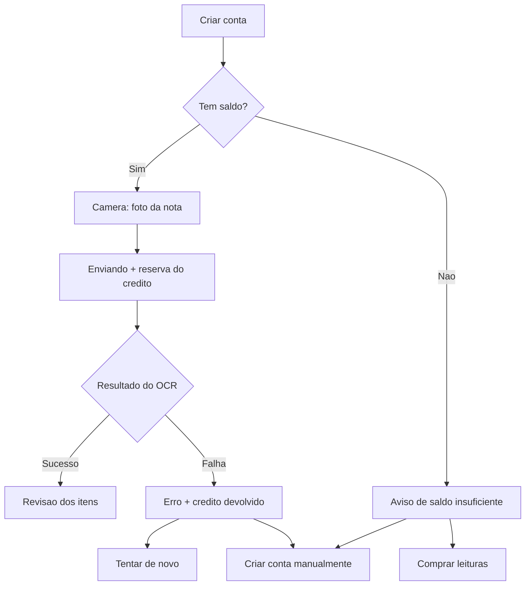

# EPIC-02 — Créditos nas telas do aplicativo

**Épico pai:** EPIC-02 — Cota gratuita e ledger de créditos

**Frente:** 01 — Qualidade e Observabilidade e 03 — Créditos e Ledger (parte de aplicativo)

**Janela principal:** a definir com o quadro do Kanban

**Atualizado em:** 24 de setembro de 2026

**Status:** rascunho para refinamento

## 1. O que este documento cobre

Este documento planeja apenas a **parte visível dos créditos no aplicativo**: onde o saldo aparece, o que o usuário vê quando não tem mais leituras, o que acontece quando a leitura falha e como o app conversa com a API de créditos.

Fora do escopo aqui: o ledger, a reserva e o consumo no backend, e a compra pela Google Play. Essas partes estão no planejamento da fase e dependem da frente de plataforma.

Regra que não muda: **criar e dividir uma conta manualmente continua gratuito, sem limite e sem depender de crédito.** Toda tela descrita abaixo precisa manter esse caminho acessível.

## 2. Situação atual do aplicativo

| Item | Como está hoje |
| --- | --- |
| Entrada do fluxo | `app/(tabs)/(create)/index.tsx` oferece duas opções: "Ler nota fiscal" e criação manual |
| Captura | `app/(tabs)/(create)/camera.tsx` envia a imagem e cria a conta |
| Espera do OCR | `app/(tabs)/(create)/scanned.tsx` consulta o status da conta a cada 2,5 s enquanto ela está em `PENDING_OCR` |
| Falha do OCR | status `OCR_FAILED`; o app chama `POST /bills/:id/retry-ocr` por `billService.retryOcr` |
| Perfil | `app/(tabs)/profile.tsx` concentra dados da conta do usuário |
| Créditos | não existe nada: nem tela, nem serviço, nem rota na API |
| Estado global | Zustand em `frontend/store/` (`authStore`, `billStore`, `rateioDraftStore`) e React Query para dados de servidor |

## 3. Onde os créditos entram



Pontos de contato no código:

1. **`(create)/index.tsx`** — mostrar o saldo ao lado da opção "Ler nota fiscal" e bloquear essa opção quando o saldo for zero.
2. **`camera.tsx`** — antes do envio, confirmar saldo; depois do envio, indicar que a leitura foi reservada.
3. **`scanned.tsx`** — durante a espera, informar que há uma leitura em uso; em `OCR_FAILED`, informar a devolução e o custo de tentar de novo.
4. **`profile.tsx`** — ponto fixo para ver o saldo fora do fluxo de criação.

## 4. Estados de tela

| Estado | Quando aparece | O que mostra | Ação principal |
| --- | --- | --- | --- |
| Saldo carregando | abertura da tela de criar conta | indicador discreto no lugar do número | nenhuma |
| Saldo disponível | saldo maior que zero | quantidade de leituras restantes | seguir para a câmera |
| Saldo insuficiente | saldo zero ao tocar em "Ler nota fiscal" | explicação e as duas saídas | criar manualmente ou comprar |
| Reserva em andamento | conta em `PENDING_OCR` | aviso de leitura em uso e tempo de espera | aguardar ou sair |
| Falha com devolução | conta em `OCR_FAILED` por erro nosso | erro, confirmação da devolução e custo da nova tentativa | tentar de novo ou criar manualmente |
| Saldo indisponível | a API de créditos não respondeu | mensagem neutra, sem número | criação manual continua liberada |

O último estado é importante: **se o serviço de créditos cair, o app não pode travar a criação manual.**

## 5. Contrato proposto para a API

A combinar com a pessoa responsável pelo ledger. Proposta mínima para as telas funcionarem:

```
GET /credits/balance
→ 200 { "balance": 3, "freeQuota": 5, "resetsAt": "2026-10-01T00:00:00Z" | null }
```

- `balance` — leituras disponíveis agora, já descontando reservas em andamento.
- `freeQuota` — total da cota gratuita do período, usado só para texto explicativo.
- `resetsAt` — quando a cota renova, ou `null` se não renova.

Para o envio da imagem, o backend deve responder de forma distinguível quando não há saldo, por exemplo `402` com um código próprio, para o app abrir a tela de saldo insuficiente em vez de mostrar erro genérico.

Em `GET /bills/:id`, durante a espera, ajuda ter o motivo da falha classificado, para o app saber se o crédito foi devolvido ou não.

## 6. Trabalho no aplicativo

1. **`services/credits.service.ts`** nos moldes dos serviços existentes, usando `apiService`.
2. **Hook `useCredits`** com React Query, invalidado depois de enviar uma nota, de uma falha de OCR e de uma compra.
3. **Componente de saldo** reaproveitável, usado na criação de conta e no perfil.
4. **Tela ou modal de saldo insuficiente**, com as duas saídas.
5. **Mensagens de reserva e devolução** em `scanned.tsx`.
6. **Origem simulada dos dados por configuração**, para as telas andarem antes de a API existir.

Itens 1 a 3 não dependem de nenhuma decisão pendente e podem começar já.

## 7. Decisões que faltam

| Decisão | Quem decide | O que trava |
| --- | --- | --- |
| Nome exibido: créditos ou leituras | cliente | todos os textos |
| Sem saldo: compra direta ou aviso com opção manual | cliente | tela de saldo insuficiente |
| Falha da leitura devolve o crédito e avisa na tela | cliente | mensagens de erro |
| Nova tentativa consome outra leitura | cliente | aviso antes do botão de tentar de novo |
| Tamanho e renovação da cota gratuita | cliente | texto do saldo e campo `resetsAt` |
| Formato da resposta de saldo | frente de plataforma | `credits.service.ts` |

## 8. Tarefas de qualidade acopladas

Três tarefas do EPIC-00 não dependem da cliente e sustentam tudo acima:

- **E00-T10 — Gate de qualidade nos PRs.** Hoje o repositório só tem a automação que restringe a origem dos PRs e a que publica o site. Nada roda testes, lint ou build.
- **E00-T05 — Diagnóstico de falhas no app.** Não existe `ErrorBoundary`, e `frontend/lib/logger.ts` descarta todo log fora do modo de desenvolvimento.
- **E00-T09 — Testes de fumaça.** O teste de ponta a ponta do backend cobre apenas `GET /`.

Sugestão de ordem: T10 primeiro, porque protege todo o resto; depois o serviço e o componente de saldo; depois T05; as telas com texto definido entram quando a cliente responder.

## 9. Referências

- [Planejamento da fase](./planejamento-epicos-nova-fase-2026.md)
- [Backlog do EPIC-00](./epic-00-qualidade-observabilidade.md)
