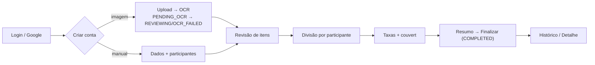

# Resumo — Fluxos, Erros a Corrigir e Melhorias

> **Foco:** descrever como o sistema funciona hoje, listar os **erros que precisam ser corrigidos** e os **pontos de melhoria** — tudo separado por área.
> **Escopo:** app Expo/React Native (`frontend/`) + API NestJS (`backend/`).

---

## 1. Fluxos atuais de funcionamento

### 1.1 Autenticação e sessão
O usuário entra por e-mail/senha ou login nativo com Google. O app guarda um `accessToken` (15 min) e um `refreshToken` (30 dias). Quando o access token expira, o cliente HTTP tenta renovar automaticamente via `/auth/refresh`; se o refresh falhar, o app faz logout. Há também recuperação de senha por código de 6 dígitos enviado por e-mail e exclusão da própria conta. No boot do app, os tokens são recarregados e o perfil é buscado para confirmar a sessão.

### 1.2 Criação de conta com imagem (OCR)
O usuário tira/seleciona uma foto da conta. O app otimiza a imagem e faz upload (preferencialmente direto ao S3 via URL pré-assinada, com fallback multipart). A API cria a conta com status `PENDING_OCR` e enfileira um job de OCR persistido no PostgreSQL. Um processador (cron a cada 10s localmente / cron externo em produção) pega o job com lock, chama a OpenAI, e grava os itens extraídos mudando o status para `REVIEWING` — ou `OCR_FAILED` se não conseguir. O app fica em polling da tela de processamento até o status mudar.

### 1.3 Criação manual e divisão
Alternativamente, o usuário cria a conta manualmente (nome, taxa de serviço, couvert, participantes). Em seguida revisa/edita itens, aloca cada item aos participantes, define taxas e vê o resumo do rateio (calculado no cliente). Ao finalizar, a API grava as divisões e taxas e marca a conta como `COMPLETED`.

### 1.4 Histórico, detalhe e perfil
As contas ficam no histórico (lista paginada com busca). O detalhe permite revisar, duplicar ou excluir uma conta. O perfil concentra avatar, tema claro/escuro, tamanho de fonte e ações de conta.

---

## 2. Erros que precisam ser corrigidos (por área)

Prioridade: 🔴 Crítico · 🟠 Alto · 🟡 Médio · ⚪ Baixo.

### 2.1 Backend — Autenticação e segurança
- 🔴 **Segredos JWT com valor padrão embutido no código.** Se as variáveis de ambiente faltarem, a API sobe usando segredos previsíveis (`auth.module.ts`, `jwt.strategy.ts:17-18`, `auth.service.ts:159,186,212`). Risco de forjar tokens.
- 🟠 **Verificação de token revogado "fail-open".** Se o banco estiver instável, um token revogado pode ser aceito (`jwt.strategy.ts:35-48`).
- 🟠 **Refresh token não é rotacionado nem detecta reuso.** O mesmo refresh vale por 30 dias sem sinal de comprometimento (`auth.service.ts:181-201`).
- 🟠 **"Sair de todos os dispositivos" não invalida sessões ativas** — apenas apaga registros de revogação (`token-revocation.service.ts:35-39`).
- 🟡 **Falha de e-mail (SMTP) quebra a resposta genérica do "esqueci a senha"**, expondo indiretamente se o e-mail existe (`mail.service.ts` + `auth.service.ts` em `forgotPassword`).

### 2.2 Backend — Tratamento de erros e configuração
- 🔴 **Não existe tratamento global de erros (ExceptionFilter).** Erros do banco (Prisma) e não previstos viram HTTP 500 opaco (`app.module.ts:55-62`, `main.ts` sem `useGlobalFilters`).
- 🟠 **Não há validação das variáveis de ambiente na inicialização.** A API sobe "verde" e quebra só em runtime quando o recurso mal configurado é usado.
- 🟡 **Vazamento de mensagens internas do banco ao cliente** na criação manual de conta (`bills.service.ts:315,344,380,392`).

### 2.3 Backend — Dados e domínio
- 🟠 **Operações de várias etapas não são atômicas (sem transação).** Finalizar conta, atualizar itens em lote, duplicar conta, excluir conta e redefinir senha podem parar no meio e deixar dados inconsistentes (`bills.service.ts` finalize/update/duplicate; `users.service.ts` deleteOwnAccount; `auth.service.ts:270-282`).
- 🟡 **Cadastro simultâneo com o mesmo e-mail** pode gerar erro 500 em vez de mensagem clara de duplicidade (`users.service.ts:39-46` e `createGoogleUser`).
- 🟡 **Divergência no cálculo do couvert (COVER_CHARGE):** o comentário diz "valor × nº de participantes", mas a soma não multiplica (`fees.service.ts:151-154`). **Precisa confirmar a regra correta** (ver documento de dúvidas).

### 2.4 Backend — Observabilidade
- 🟠 **Endpoint `/metrics` é público, sem proteção** — expõe métricas internas e a última mensagem de erro do OCR (`metrics.controller.ts:5-13`).
- 🟡 **`/health` sempre responde "ok"** mesmo com o banco caído e **inclui a mensagem de erro do banco** no corpo público (`app.controller.ts:34,60,64`).

### 2.5 Frontend — Estabilidade
- 🔴 **Não há ErrorBoundary.** Qualquer exceção durante o render derruba a tela sem tela de recuperação (`app/_layout.tsx`). Risco concreto no resumo do rateio se um participante ficar inconsistente (`lib/rateio.ts` `buildRateioSummary`).
- 🟠 **Polling de OCR sem tempo limite.** Se o OCR travar em `PENDING_OCR`, o usuário fica no "Processando..." para sempre; a ação de reprocessar (`retryOcr`) existe no código mas nenhuma tela a mostra (`app/(tabs)/(create)/scanned.tsx`, `services/bill.service.ts`).
- 🟠 **No boot, falha de rede joga o usuário logado para o login** sem opção de tentar de novo (`store/authStore.ts:216+` + `app/index.tsx`).

### 2.6 Frontend — Observabilidade e integrações
- 🟠 **Logger é desligado em produção** — nenhum erro é registrado e não há crash reporting, então falhas em produção ficam invisíveis (`lib/logger.ts:9-29`).
- 🟡 **Upload direto ao S3 não tem tempo limite próprio** (só o fallback tem), podendo travar em rede ruim (`services/bill.service.ts`).

---

## 3. Principais pontos de melhoria (por área)

Estes itens não são falhas que quebram o sistema hoje, mas aumentariam a robustez, a consistência e a observabilidade.

### 3.1 Backend — Autenticação e segurança
- Introduzir rotação de refresh token com detecção de reuso.
- Redefinir a semântica de "sair de todos os dispositivos" para realmente invalidar sessões.
- Avaliar verificação de e-mail para contas com senha (hoje só o Google marca e-mail verificado).

### 3.2 Backend — Confiabilidade e configuração
- Validar variáveis de ambiente no boot (fail-fast) e remover valores padrão de segredos.
- Padronizar tradução de erros do banco para respostas HTTP semânticas (ex.: duplicado → 409, não encontrado → 404).
- Envolver operações multi-etapa em transações para garantir atomicidade.
- Adicionar encerramento gracioso da conexão com o banco no deploy (`enableShutdownHooks`).

### 3.3 Backend — Observabilidade
- Proteger `/metrics` e evitar expor mensagens internas em `/health` e `/metrics`.
- Refletir o estado real do banco no `status` do `/health`.
- Padronizar logging estruturado no lugar de `console.*` espalhado.
- Avaliar persistência/agregação de métricas (hoje ficam em memória e se perdem a cada restart/instância).

### 3.4 Frontend — Estabilidade e UX de falha
- Adicionar ErrorBoundary global com tela de recuperação.
- Colocar tempo limite e limite de tentativas no polling de OCR, com mensagem de falha e botão de reprocessar (ligando ao `retryOcr` já existente).
- Melhorar o comportamento offline no boot (retry / tela "sem conexão") em vez de deslogar.

### 3.5 Frontend — Consistência e observabilidade
- Habilitar logging/crash reporting em produção.
- Padronizar o formato de erro entre os serviços do app (hoje há três estilos diferentes).
- Detectar conectividade e persistir o rascunho de rateio para não perder o trabalho do usuário.
- Unificar o separador decimal (ponto vs vírgula) entre as telas de entrada numérica.

---

## 4. Como priorizar (visão rápida)

| Ordem sugerida | Itens |
| --- | --- |
| **Primeiro (Crítico)** | Tratamento global de erros no backend · ErrorBoundary no app · Remover segredos padrão + validar env |
| **Depois (Alto)** | Transações nas operações multi-etapa · Timeout/retry visível no OCR · Proteger `/metrics` · Fail-open da blacklist · Logger/crash reporting em produção |
| **Em seguida (Médio/Baixo)** | Rotação de refresh · `/health` real · Vazamento de mensagens · Offline/persistência de rascunho · Consistência de erro e de separador decimal |
